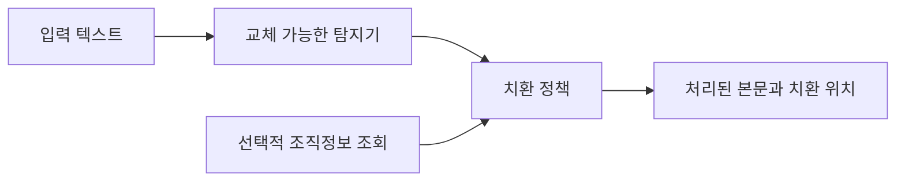

# KoPII-Pipeline

**한국어 개인정보 탐지·조직정보 기반 범주화·재현 가능한 평가를 위한 Python 패키지입니다.**

한국어 이름·연락처·식별번호를 탐지하고, 이름을 허용된 부서명이나 가명으로 바꿔 문서 요약과 검색에 활용하는 흐름을 다룹니다. 한국어 PII 데이터셋과 RoBERTa 모델을 별도로 공개했으며, 이 저장소에는 **로컬 처리 라이브러리·CLI, 모델 어댑터, 연구 실행 도구와 논문 초안**을 제공합니다. 공개 패키지는 특정 서비스나 인사 DB에 의존하지 않습니다.

[프로젝트 개요](docs/public/overview.md) · [모델](https://huggingface.co/seongyeon1/ko-pii-ner-roberta-base) · [데이터셋](https://huggingface.co/datasets/seongyeon1/ko-pii-ner-100k) · [비교 결과](docs/public/benchmark-results.md) · [과거 비교 실행 방법](benchmarks/pii_compare/README.md) · [라이브러리 사용법](docs/public/library.md) · [연구 계획](research/PLAN.md) · [논문 초안](paper/manuscript.md)

## 무엇을 해결하나요?

이름을 모두 같은 기호로 지우면 문서에서 담당 조직을 파악하기 어려워질 수 있습니다. 탐지와 치환 정책을 분리해, 소속이 확인된 이름은 선택한 조직 수준으로 범주화하는 방식을 사용합니다.

> 설명용 가상 예시
>
> 처리 전: 김하늘이 배포 일정을 확인했습니다.
>
> 처리 후: [이름:플랫폼개발팀 보호]이 배포 일정을 확인했습니다.

부서명은 **별도의 인사·조직 정보 조회**로 결정합니다. 모델에 직원 명부를 학습시키거나 모델이 이름만으로 소속을 추측하는 구조가 아닙니다. 소속을 확인하지 못하면 설정에 따라 문서 단위 가명 또는 이름 보호 표시를 사용합니다.

범주화는 업무 문맥을 남기기 위한 선택입니다. 부서명과 주변 정보가 결합되면 개인을 유추할 수 있으므로 완전한 익명성이나 검색·요약 품질을 보장하지 않습니다.

## 빠른 시작

Python 3.11 이상에서 저장소를 내려받은 뒤 실행합니다. 기본 설치는 외부 런타임 의존성이나 GPU가 필요하지 않습니다.

```bash
python -m venv .venv
source .venv/bin/activate
python -m pip install -e .
kopii process --config configs/demo.json --input examples/document.txt --document-id demo-1
```

데모는 가상 조직 CSV와 이름 사전을 사용합니다. 모델 정확도 시연이나 직원 명부 학습이 아닙니다. 실제 한국어 NER는 선택 의존성을 설치해 사용합니다.

```bash
python -m pip install -e '.[hf]'
kopii process --config configs/roberta.json --input examples/document.txt --document-id demo-1
```

첫 실행에는 모델 다운로드가 필요합니다. 기본 장치는 CPU이며 설정에서 MPS/CUDA를 선택할 수 있습니다. 패키지는 아직 PyPI에 게시하지 않았습니다.

## 현재 제공 범위

| 항목 | 상태와 위치 |
| --- | --- |
| 문서 처리 라이브러리·CLI | 구현 · `src/kopii`, [사용법](docs/public/library.md) |
| 모델 어댑터 | Hugging Face BIO, GLiNER, GLiNER2, 제한된 규칙 탐지 |
| 조직정보 연계 | 교체 가능한 Resolver + 가상 CSV 예제 |
| 처리 정책 | 마스킹·문서 단위 가명·조직 범주화, 탐지 오류 전파 |
| 새 연구 실행기 | 실험 식별·이어쓰기 검증·탐지 지표·그룹 부트스트랩 |
| 새 합성·학습 기준선 | 작은 fixture 합성기 + CE 학습; 기존 100k/배포 모델의 재현 코드는 아님 |
| 한국어 데이터셋·모델 | 별도 [데이터셋](https://huggingface.co/datasets/seongyeon1/ko-pii-ner-100k)·[체크포인트](https://huggingface.co/seongyeon1/ko-pii-ner-roberta-base) |
| 기존 모델 비교 | 2026-09-15 코드·결과 보존; 새 패키지 결과와 구분 |
| 논문 | [영문 작업 초안](paper/manuscript.md) · 추가 연구 결과 미측정 |
| 서비스 통합 | 문서 파서·HTTP 서버·실제 HR 연결·검색 엔진은 배포 범위에서 제외 |

기본 정책은 **탐지된 모든 유형을 마스킹**합니다. 기존 운영 사례의 선택적 치환 정책과 다릅니다. API 마커는 `[PERSON_NAME:조직명]` 형식이며 위 서비스 적용 예시의 화면용 한글 마커와 구분합니다. 초기 설계의 복원 저장소와 조사 교정은 제공하지 않습니다.

## 구조

```text
src/kopii/
  detectors/     # 모델·규칙 → 원문 문자 위치
  resolvers/     # 이름 → 외부 조직정보
  policies.py    # 마스킹·가명·조직 범주화
  pipeline.py    # 처리 흐름과 실패 계약
  rendering.py   # 겹침 구간과 출력 위치
  research/      # 데이터 검사·합성·학습·평가
configs/         # 고정 revision과 명시적 실행 설정
examples/        # 가상 조직·문서
research/        # 재현 방법과 미완료 실험 계획
paper/           # 논문 초안·참고문헌
```



## 기존 공개 데이터와 모델

[ko-pii-ner-100k](https://huggingface.co/datasets/seongyeon1/ko-pii-ner-100k)는 공개 한국어 자료와 템플릿 기반 업무 문서 합성을 결합한 **100,851건**의 데이터셋입니다. 공개 원문의 개인정보 값을 유지한 구간도 있어, 전체가 새로 만든 가상 정보는 아닙니다.

| 구간 | 레코드 수 |
| --- | ---: |
| 학습 | 78,963 |
| 검증 | 9,994 |
| 내부 테스트 | 9,888 |
| KDPII 기반 별도 평가 | 2,006 |
| 합계 | 100,851 |

자체 합성은 문장 조각과 문서 양식에 가상 정보를 넣는 방식이며, 같은 문서 안의 인물 정보와 한국어 조사를 고려했습니다. 비개인정보 문서도 포함해 주문번호·제품명 등을 개인정보로 오인하는 경우를 평가합니다.

[ko-pii-ner-roberta-base](https://huggingface.co/seongyeon1/ko-pii-ner-roberta-base)는 [klue/roberta-base](https://huggingface.co/klue/roberta-base)를 **20개 유형, BIO 41개 클래스**의 토큰 분류 과제에 맞춰 파인튜닝한 모델입니다. 학습한 유형과 서비스에서 실제 치환하는 유형은 구분하며, 업무 목적에 맞게 처리 정책을 선택합니다.

## 기존 도입 검토 모델 비교

NVIDIA와 Fastino 모델은 초기에 도입을 검토했던 후보입니다. 다음 수치는 과거 비교 스크립트로 측정했으며, 새 패키지로 다시 산출한 결과가 아닙니다.

2026년 9월 15일, **KDPII 기반 2,006건 + 비개인정보 합성 문서 580건**을 세 모델에 동일하게 적용했습니다. F1은 공통 13개 범주의 문자 시작·끝과 유형이 모두 맞아야 정답으로 처리한 결과입니다.

| 모델 | Exact F1 | 이름 Exact 재현율 | 비개인정보 문서 오탐 |
| --- | ---: | ---: | ---: |
| [KoPII RoBERTa base](https://huggingface.co/seongyeon1/ko-pii-ner-roberta-base) | **91.10%** | **96.05%** | **0 / 580** |
| [NVIDIA GLiNER-PII](https://huggingface.co/nvidia/gliner-PII) | 8.73% | 12.43% | 559 / 580 |
| [Fastino GLiNER2-PII](https://huggingface.co/fastino/gliner2-privacy-filter-PII-multi) | 19.87% | 18.36% | 182 / 580 |

이 결과는 **한국어로 파인튜닝한 모델과 한국어 추가 학습·설정 최적화 없이 적용한 공개 모델의 비교**입니다. GLiNER 계열의 기본 추출기는 이름과 조사를 한 단어로 취급할 수 있습니다. 이름 정답 354개 중 244개가 기본 단어 경계로 정확히 표현되지 않아, 낮은 점수에는 이 경계 제약도 반영돼 있습니다. 라벨 표현과 임계값 역시 한국어 검증셋으로 최적화하지 않았습니다.

- 평가에는 `test_kdpii.jsonl` 전량과 `test.jsonl`의 L4 구간을 사용했습니다. 학습·검증 레코드는 이번 평가에 사용하지 않았습니다.
- KDPII 2,006건은 대화 458건과 해당 대화의 단문 1,548건입니다. 모두 독립적인 대화는 아닙니다.
- 비개인정보 문서는 학습 데이터와 같은 합성 파이프라인 계열입니다. 오탐 0건을 실제 업무 전체의 오탐률로 일반화하지 않습니다.
- 평가 장치는 Apple M4 Pro, PyTorch MPS입니다. 서빙에 사용한 동일 revision을 로컬에서 평가했으며 운영 서버 HTTP 출력·지연시간이나 인사정보 매칭 정확도를 측정한 결과는 아닙니다.

유형별 점수, 문자 보호율, 실행 조건과 한계는 [상세 비교 결과](docs/public/benchmark-results.md)에 정리했습니다. 각 모델의 최적 성능이나 다른 언어에서의 우열을 뜻하지 않습니다.

## 새 연구 실행

```bash
kopii synthesize --output output/fixture-data --per-template 12
kopii evaluate --config configs/eval-rules.json \
  --data output/fixture-data/test.jsonl --output output/rules-fixture
```

fixture 점수는 실행 검증용입니다. 실제 연구의 데이터 분할·신경망 평가·학습 명령과 실험 이어쓰기 조건은 [연구 실행 안내](research/README.md)를 참고하세요. 한국어 설정 최적화, 범주화 이후 검색 품질, 개인 추정 위험 비교는 아직 수행하지 않았습니다.

## 개발 검증

```bash
python -m pip install -r requirements-dev.lock.txt
python -m pip install --no-deps -e .
pytest -q
ruff check src tests
ruff format --check src tests
mypy src/kopii
python -m build
```

CI는 모델 다운로드 없이 패키지·오프라인 예제·연구 fixture를 확인합니다. 신경망 어댑터의 실제 가중치 검증은 별도 실행입니다. [검증 기록](docs/public/verification.md)에 범위를 남깁니다.

## 문서와 재현

- [프로젝트 개요와 서비스 적용 흐름](docs/public/overview.md)
- [모델 비교 결과와 해석](docs/public/benchmark-results.md)
- [벤치마크 실행 방법](benchmarks/pii_compare/README.md)
- [초기 비식별 파이프라인 설계](docs/design/2026-08-28-pii-anonymize-design.md) — 초기 제안이며 현재 구현·공개 범위와 다릅니다.
- [초기 합성 코퍼스 구현 계획](docs/plans/2026-08-28-synth-corpus.md) — 계획 문서이며 실행 가능한 합성 도구를 의미하지 않습니다.

벤치마크에는 모델 가중치와 평가 데이터의 별도 다운로드가 필요합니다. 이 저장소에는 직원 명부, 실제 조직 정보, 운영 문서, 서비스 접속 정보와 비밀키를 포함하지 않습니다. [PII 검사 스크립트](scripts/pii_scan.py)는 일부 패턴을 검사하는 보조 도구이며 모든 개인정보나 비밀정보의 탐지를 보장하지 않습니다.

## 라이선스

이 저장소의 코드는 [MIT](LICENSE) 라이선스를 따릅니다. 별도 공개 자산의 카드에는 데이터셋 **CC-BY-4.0**, 모델 **CC-BY-SA-4.0**으로 표시돼 있습니다. 저장소의 MIT 라이선스가 모델·데이터·상위 원천 자료에 일괄 적용되는 것은 아닙니다. 각 자산과 기반 모델·원천 데이터의 이용 조건을 따로 확인하세요.
