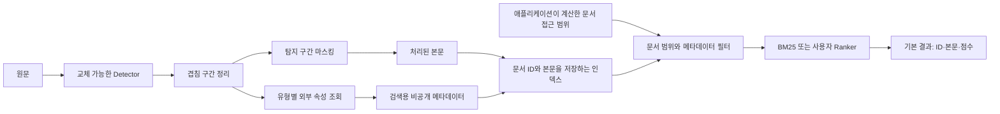

# 임의의 메타데이터를 사용하는 문서 처리와 검색

0.2.0부터 가상 조직 실험과 독립된 문서 처리·검색 API를 제공한다. 조직 이름이나 팀/본부/센터 계층은 코어에 고정하지 않는다. Python 3.11 이상에서 기본 기능은 외부 런타임 의존성 없이 실행된다. 배포형 검색 서버나 인증 서비스는 포함하지 않는다.

## 처리 구조



`ContextPipeline`은 탐지를 한 번 실행한 뒤 모든 탐지 구간을 마스킹한다. 속성 조회는 탐지된 유형의 표면 문자열만 사용하며, 출력 마커를 다시 파싱하지 않는다. 임의의 필드마다 별도의 `Resolver`와 `entity_label`을 지정할 수 있다. 탐지 오류는 전파하고, 조회 실패·누락·모호성은 해당 속성 없음으로 처리한다. 원문 이름이나 외부 예외 메시지를 진단에 넣지 않는다.

## 전체 흐름 실행

저장소 루트에서 실행한다. 예제의 세 문서·이름·부서 코드·지역은 모두 설명용 가상 자료다.

```bash
python -m pip install -e .
kopii prepare \
  --config configs/context-demo.json \
  --input examples/search/documents.jsonl \
  --output output/search-demo/index.jsonl
kopii search \
  --index output/search-demo/index.jsonl \
  --query '배포 일정' \
  --scope examples/search/scope.json \
  --filters examples/search/filters.json
kopii evaluate-search \
  --index output/search-demo/index.jsonl \
  --queries examples/search/queries.jsonl \
  --limit 5
```

검색 예제는 `record-a`만 반환한다. `record-b`는 속성 필터에 맞지 않고, `record-c`는 문서 접근 범위에 없다. 메타데이터는 기본 결과에 포함되지 않는다. `prepare`는 기존 출력 파일을 덮어쓰지 않으므로 재실행에는 새 경로를 지정한다.

입력 JSONL은 `id`, `text`만 포함한다. 추가 필드와 중복 ID는 거부한다. 출력 인덱스에는 마스킹된 본문과 **비공개** `metadata`가 함께 들어가며 파일은 소유자 읽기/쓰기 권한으로 생성한다. 공개 문서 출력과 이 인덱스를 혼동하지 않는다. 미탐 개인정보는 본문에 남을 수 있다.

```json
{"id":"record-a","text":"[PERSON_NAME]이 배포를 검토했다.","metadata":{"business_unit":["product"],"region":["west"]}}
```

`business_unit`과 `region`은 예제 설정일 뿐이다. [설정 파일](../../configs/context-demo.json)의 필드명, CSV `key`·`value`·`ambiguity_fields`를 바꾸면 다른 계층이나 업무 속성을 사용한다. `ambiguity_fields`에 지정한 열이 서로 다른 행은 최종 반환 값이 같아도 모호한 조회로 처리한다. 데이터베이스 연결은 같은 `Resolver.resolve()` 계약으로 구현한다.

## Python에서 연결

```python
from kopii import ContextField, ContextPipeline, SearchIndex
from kopii.detectors.rules import DictionaryDetector
from kopii.resolvers.attributes import AttributeResolver

resolver = AttributeResolver(
    [{"display_name": "김하늘", "unit": "product", "region": "west"}],
    key="display_name",
    value="region",
    ambiguity_fields=["unit"],
)
processor = ContextPipeline(
    DictionaryDetector(["김하늘"]),  # 예제 전용; 실제 Detector로 교체
    {"region": ContextField(resolver, entity_label="PERSON_NAME")},
)
prepared = processor.process("김하늘이 배포 일정을 검토했다.", "record-a")
index = SearchIndex([prepared.document])
hits = index.search(
    "배포 일정",
    allowed_ids={"record-a"},  # 실제 서비스에서는 서버가 권한을 확인해 계산
    filters={"region": {"west"}},
    k=5,
)
public_result = [hit.to_dict() for hit in hits]
private_record = prepared.document.to_dict(include_metadata=True)
```

여러 인물이 한 문서에 나오면 필드별 값의 합집합을 저장한다. 필드 간 인물별 대응이나 “동일 인물의 부서와 지역”을 추론하는 구조가 아니다. 그런 조건이 필요하면 애플리케이션에서 인물 단위의 별도 데이터 모델과 조회기를 제공해야 한다.

## 검색 계약

| 요소 | 계약 |
|---|---|
| `SearchDocument` | 고유 ID·처리된 본문·문자열 집합 메타데이터. 입력 메타데이터를 복사해 외부 변경을 차단 |
| `allowed_ids` | 반드시 명시하는 문서 ID 집합. 빈 집합이면 검색기를 호출하지 않음 |
| `filters` | 필드 간 AND, 필드 내부 값 간 OR. 없는 필드나 빈 허용값이면 일치하지 않음 |
| `Ranker.score()` | 범위·필터를 통과한 문서만 받아 입력 순서대로 유한 점수 반환 |
| `SearchHit.to_dict()` | 기본 ID·본문·점수. 메타데이터 노출은 명시적 옵션 |

필터는 순위 계산과 top-k 이전에 적용한다. 조직명이 포함된 자연어 질의에서 필터를 자동 추정하지 않는다. `allowed_ids`는 인증을 대신하는 값이 아니다. 서비스에서는 사용자가 보낸 임의 목록을 그대로 신뢰하지 말고 기존 권한 체계에서 계산한 범위를 연결한다. 메타데이터를 직접 반환하거나 필터를 관찰할 수 있는 사용자는 그 정보로 개인을 추정할 수 있다. [실험의 관찰 조건](../../research/results/metadata-tables.md)을 참고한다.

기본 `LexicalRanker`는 Unicode 영숫자의 문자 bigram과 BM25를 사용한다. 사용자 토크나이저를 생성자에 전달할 수 있다. 통계는 매 질의의 허용 후보 안에서 계산한다. 이는 전체 가상 코퍼스의 순위를 계산한 뒤 필터링하는 기존 연구 기준선과 다른 정의이므로 두 결과를 같은 설정으로 비교하지 않는다. 언어별 품질 보증이나 자동 형태소 분석은 제공하지 않는다.

## 임베딩 검색기 교체

로컬 모델은 `Embedder.embed(texts, purpose=...)`를 구현하면 된다. HTTP 서버는 패키지의 `HttpEmbedder`를 사용할 수 있다. 장치나 공급자를 고정하지 않으며 NPU 실행 여부도 자동 판단하지 않는다.

```python
import os
from kopii.embeddings import HttpEmbedder, VectorRanker

embedder = HttpEmbedder(
    endpoint=os.environ["KOPII_EMBEDDING_ENDPOINT"],
    model="your-deployed-model-id",
    api_key=os.environ.get("KOPII_EMBEDDING_API_KEY"),
    document_prefix="",  # 모델의 실제 전처리 계약에 맞춰 설정
    query_prefix="",
)
index = SearchIndex([prepared.document], ranker=VectorRanker(embedder))
```

CLI에서는 [임베딩 설정 예제](../../configs/embedding-study.example.json)를 로컬 `output/embedding-config.json`에 복사해 실제 모델 ID·운영 배포 revision·prefix를 기록한 뒤 `search`나 `evaluate-search`에 `--embedding-config output/embedding-config.json`을 추가한다. API 주소·인증 키는 환경변수로 전달한다. HTTP API는 `model`, `input`, `encoding_format` 요청과 `data[].index/embedding` 응답 계약을 사용한다.

이 참조 구현은 질의마다 후보 본문을 다시 임베딩한다. 큰 코퍼스용 영속 벡터 인덱스·배치 스케줄러·캐시는 제공하지 않는다. 그런 검색기는 `Ranker` 계약으로 연결한다. HTTP 응답 순서·개수·차원·0 벡터·유한값을 검증하며, 모델 불일치나 리다이렉트는 거부한다. 잘못된 벡터를 조용히 0점 처리하지 않는다.

## 사용자 평가셋

질의 JSONL은 `id`, `text`, `allowed_ids`, `relevant_ids`를 요구하고 `filters`를 선택적으로 받는다. 관련 문서는 실제 인덱스와 접근 범위 안에 있어야 하며, 정답 집합이 빈 질의는 거부한다. 필터가 관련 문서를 제거한 경우에는 실제 누락으로 채점한다.

```json
{"id":"query-a","text":"배포 일정","allowed_ids":["record-a"],"relevant_ids":["record-a"],"filters":{"region":["west"]}}
```

`evaluate-search`는 질의별 Recall@k·Precision@k·MRR@k·빈 결과율의 단순 평균을 계산한다. Precision의 분모는 반환 수가 아니라 k이며 MRR은 top-k에서 절단한다. 출력에는 인덱스·질의·임베딩 설정 해시를 남기고 질의 본문을 복사하지 않는다. 배포 revision은 제공자가 적은 설정이며 서버 가중치 검증은 아니다. 예제 두 질의의 점수는 실행 확인용이며 실제 업무 성능 증거가 아니다.

이 평가는 개인 추정 공격이나 익명성 보증을 일반화한 도구가 아니다. 기존 가상 조직 공격 실험은 `research/`에 별도로 유지한다. 실제 문서와 명부는 공개 저장소로 복사하지 않고 승인된 별도 평가 환경에서 처리한다.

## 기존 사용자와의 호환

`Pipeline`, `Policy`, 기존 팀/본부/센터 `CsvResolver`, `process` 명령은 유지한다. 새 `AttributeResolver`와 `ContextPipeline`을 사용하면 그 계층 제약 없이 본문 마스킹과 속성 저장을 분리할 수 있다. 과거 실험의 `DenseIndex`·벡터 검증 import는 호환 경로를 유지한다. 코어 소스와 패키지 버전이 바뀌었으므로 기존 연구 실행 디렉터리에 이어쓰지 말고 새 출력 경로를 사용한다.
