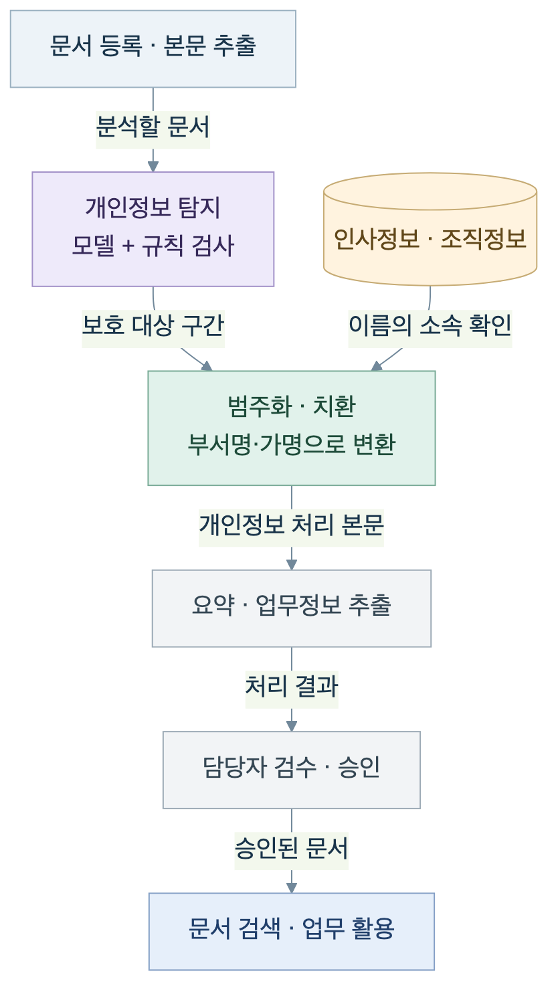

# 한국어 개인정보 탐지와 문서 범주화

한국어 문서에서 개인정보 구간을 찾고, 허용된 부서명·가명·보호 표시로 변환해 업무 문맥을 남기는 프로젝트입니다. 공개 자료와 업무 문서 합성으로 데이터셋을 구성하고 한국어 RoBERTa를 학습했습니다. 이 문서는 데이터와 모델, 서비스에 연결하는 방식, 평가 결과의 적용 범위를 설명합니다.

**공개 범위:** 이 저장소는 설계·적용 문서와 모델 비교 코드를 제공합니다. 학습 모델과 데이터셋은 Hugging Face에서 배포하며, 데이터 생성·학습 도구와 운영 문서 처리 서비스는 이 저장소에서 제공하지 않습니다.

[저장소 소개](../../README.md) · [비교 결과](benchmark-results.md) · [모델](https://huggingface.co/seongyeon1/ko-pii-ner-roberta-base) · [데이터셋](https://huggingface.co/datasets/seongyeon1/ko-pii-ner-100k)

## 목적

문서의 이름과 연락처 등을 보호하면서 담당 조직과 업무 내용은 활용할 수 있도록 탐지와 치환을 분리했습니다. 모델은 개인정보의 유형과 위치를 찾고, 서비스 정책이 어떤 정보를 어느 수준으로 바꿀지 결정합니다.

이름의 소속은 별도의 인사·조직 정보에서 확인합니다. 사내 직원 명부를 모델 학습에 넣거나 모델이 소속을 추론하는 방식이 아닙니다. 개인정보 탐지 모델과 검색용 임베딩 모델도 역할이 다르므로 별도로 구성합니다.

## 데이터 구축

[ko-pii-ner-100k](https://huggingface.co/datasets/seongyeon1/ko-pii-ner-100k)는 다음 자료를 결합한 100,851건의 데이터셋입니다.

- 공개 한국어 대화의 문맥과 개인정보 표시를 활용한 자료
- 공개 데이터의 한국어 문맥에 한국식 개인정보 값을 반영한 자료
- 고객상담·사내메일·의료·금융·공공민원·채용 양식의 합성 문서
- 주문번호·제품명 등을 개인정보로 잘못 판단하는 경우를 확인하기 위한 비개인정보 문서

자체 합성은 문장 조각과 문서 양식에 가상 정보를 넣는 방식입니다. 같은 문서에 등장하는 인물 정보의 일관성과 이름 뒤에 붙는 한국어 조사를 반영했습니다. 공개 원문을 활용한 구간에서는 원래 값을 유지한 경우도 있어 **전체가 가상 개인정보로 새로 합성된 데이터는 아닙니다.**

| 데이터 구간 | 레코드 수 | 용도 |
| --- | ---: | --- |
| 학습 | 78,963 | 모델 학습 |
| 검증 | 9,994 | 모델 선택·점검용 자료 |
| 내부 테스트 | 9,888 | 구축 데이터 내 성능 점검 |
| KDPII 기반 별도 평가 | 2,006 | 대화 기반 홀드아웃 평가 |
| 합계 | 100,851 | 전체 데이터 구성 |

개인정보 유형과 문자 위치를 검사하고 동일 문장과 반복 구조를 점검했습니다. 동일 대화에서 나온 자료는 학습·검증·내부 테스트 사이에 그룹 단위로 분리하며, 별도 평가 자료와 학습 계열 자료 사이의 동일 문장 중복도 제거했습니다. 각 구간의 전체 수량이 모든 학습 중 점검에서 사용한 표본 수를 의미하지는 않습니다.

## 모델 학습

[klue/roberta-base](https://huggingface.co/klue/roberta-base)를 토큰 분류 과제에 맞춰 파인튜닝해 [한국어 PII 모델](https://huggingface.co/seongyeon1/ko-pii-ner-roberta-base)을 공개했습니다. 문장 안에서 개인정보가 시작하고 끝나는 위치와 유형을 함께 학습합니다.

학습 대상은 20종이며, 각 유형의 시작·연속 태그와 비개체 태그를 합한 BIO 41개 클래스를 사용합니다. 다음 분류는 프로젝트의 데이터 라벨 체계입니다.

| 묶음 | 학습 유형 |
| --- | --- |
| 식별번호 | 주민등록번호, 외국인등록번호, 여권번호, 운전면허번호 |
| 이름·연락처·기타 식별 정보 | 이름, 전화번호, 이메일, 주소, 계좌번호, 카드번호, 사업자등록번호, 사용자 ID, 개인 URL, 차량번호, IP 주소 |
| 문맥상 보호 여부를 정하는 정보 | 생년월일, 나이, 소속, 직위, 민감 속성 |

학습 유형 전체를 서비스에서 자동 치환할 필요는 없습니다. 소속·직위 등은 업무 목적과 문서 공개 범위에 따라 처리 정책을 선택합니다. 모델의 누락·오탐은 담당자 검수와 별도 규칙 검사로 함께 관리합니다.

## 서비스 통합 방식

아래는 별도 문서 처리 서비스에 적용한 흐름을 일반화한 그림입니다. 그림의 인사정보 연결과 승인·검색 기능은 이 저장소의 실행 가능한 서비스가 아닙니다.

문서 본문에서 개인정보를 탐지한 뒤, 탐지한 이름의 소속을 인사·조직 정보에서 조회합니다. 허용한 조직 수준으로 이름을 치환한 본문을 요약과 업무정보 추출에 사용하고, 담당자가 검수·승인한 문서를 검색에 활용합니다.

### 이름을 부서명으로 범주화

조직 정보에 따라 팀·본부·센터 중 표시 수준을 선택합니다.

> 설명용 가상 예시
>
> 처리 전: 김하늘이 배포 일정을 확인했습니다.
>
> 처리 후: [이름:플랫폼개발팀 보호]이 배포 일정을 확인했습니다.

조회 결과로 소속을 확정하지 못하면 설정에 따라 문서 단위 가명을 사용합니다. 가명 생성 조건도 충족하지 못하면 이름 보호 표시로 치환합니다. 가명은 같은 문서의 같은 이름을 일관되게 표시하는 용도이며, 이름만으로 동명이인을 구분하는 기능은 아닙니다.

이름을 부서로 바꿔도 직위·업무 내용 등의 주변 정보로 개인을 유추할 수 있습니다. 문서의 열람·배포 범위와 조직 규모를 고려해 표시 수준을 정해야 합니다. 범주화만으로 완전한 익명성이나 일정한 검색·요약 품질이 보장되지는 않습니다.

### 처리 상태와 검수

적용 서비스에서는 개인정보 탐지 실패 시 해당 실행의 후속 처리를 중단하고, 수정한 페이지를 다시 점검하며, 개인정보 처리가 끝나지 않은 페이지의 승인을 제한하는 흐름을 구성했습니다.

이는 문서 본문 처리 단계의 동작입니다. 원본 파일 보관과 접근 권한, 본문 추출 단계는 별도 관리 대상입니다. 탐지 실패와 인사정보 조회 실패도 구분하며, 소속을 확인하지 못한 이름은 위의 가명·보호 표시 정책으로 처리합니다.

## 모델 비교

2026년 9월 15일 세 모델을 동일한 평가 데이터와 장치에서 비교했습니다.

| 평가 자료 | 수량 | 목적 |
| --- | ---: | --- |
| `test_kdpii.jsonl` 전체 | 2,006건 | 한국어 대화의 개인정보 탐지 |
| `test.jsonl` 중 L4 | 580건 | 비개인정보 합성 문서의 오탐 |
| 합계 | 2,586건 | 세 모델 공통 평가 |

학습·검증 자료는 이번 평가에 사용하지 않았습니다. KDPII 구간은 대화 458건과 그 대화에서 추출한 단문 1,548건으로, 모두 독립적인 대화는 아닙니다. 비개인정보 문서는 학습 자료와 같은 합성 파이프라인 계열이므로 자연 발생 업무 문서 전체의 오탐률을 대변하지 않습니다.

| 모델 | 공통 범주 Exact F1 | 이름 Exact 재현율 | 비개인정보 문서 오탐 |
| --- | ---: | ---: | ---: |
| KoPII RoBERTa base | 91.10% | 96.05% | 0 / 580 |
| NVIDIA GLiNER-PII | 8.73% | 12.43% | 559 / 580 |
| Fastino GLiNER2-PII | 19.87% | 18.36% | 182 / 580 |

F1은 공통 13개 범주의 정답 구간 1,878개를 기준으로 문자 시작·끝과 유형이 모두 일치해야 정답으로 계산했습니다. 이름 재현율은 정답 이름 354개 중 정확하게 추출한 비율입니다. 이번 모델 비교에는 정규식 검사, 인사정보 조회와 원본 치환을 적용하지 않았습니다.

운영에 사용한 것과 동일한 revision의 모델을 **Apple M4 Pro / PyTorch MPS에서 로컬 평가**했습니다. 운영 서버의 현재 출력이나 HTTP 지연시간, 전체 서비스의 처리 품질을 측정한 결과는 아닙니다.

### 비교 결과의 해석 범위

두 GLiNER 모델은 한국어 추가 학습과 한국어 검증셋을 통한 라벨 표현·임계값 최적화 없이 적용했습니다. 기본 단어 분리기가 이름과 조사를 하나로 취급할 수 있어, 이름 정답 354개 중 244개는 기본 단어 경계로 정확하게 표현할 수 없었습니다.

개인정보 문자 재현율은 NVIDIA 88.53%, Fastino 81.45%였습니다. 개인정보를 일부 인식해도 경계나 유형이 틀리면 Exact 점수는 낮아집니다. 반대로 주변 문구를 넓게 잡아도 문자 재현율은 높아질 수 있어, 오탐과 정확한 경계 평가를 함께 봐야 합니다. 경계 처리만 개선했을 때의 성능 상승 폭은 측정하지 않았습니다.

NVIDIA 카드에는 영어 모델로 표시돼 있고, Fastino가 명시한 추가 학습 언어 7개에는 한국어가 없습니다. 이는 기반 모델이 한국어를 전혀 학습하지 않았다는 의미가 아닙니다. 이번 수치는 해당 설정으로 한국어에 적용한 결과이며, 각 모델의 최적 성능이나 모든 언어에서의 우열로 해석하지 않습니다. [NVIDIA 모델 카드](https://huggingface.co/nvidia/gliner-PII), [Fastino 모델 카드](https://huggingface.co/fastino/gliner2-privacy-filter-PII-multi)

더 자세한 수치와 조건은 [비교 결과](benchmark-results.md), 재현 절차는 [벤치마크 실행 방법](../../benchmarks/pii_compare/README.md)을 참고하세요.

## 추가 검증 범위

모델의 개인정보 탐지 품질과 실제 서비스의 처리 품질은 별도로 확인해야 합니다.

- 실제 업무 문서 표본에서 유형별 누락·오탐 측정
- 인사정보 소속 해석과 동명이인 처리 점검
- 문서 배포 범위에 따른 부서 표시 수준 결정
- 문서 수정·검수·승인까지 전체 처리 과정 점검
- 목표 서버에서 문서 길이·동시 요청 수에 따른 성능 측정

공개 모델의 설정을 개선해 비교할 때는 별도 검증 자료로 라벨·임계값 등을 선택하고, 그 선택에 사용하지 않은 평가 자료로 다시 측정합니다.

## 공개 자산과 이용 조건

- [한국어 PII 데이터셋](https://huggingface.co/datasets/seongyeon1/ko-pii-ner-100k): 카드의 라이선스 표기는 CC-BY-4.0
- [한국어 PII 모델](https://huggingface.co/seongyeon1/ko-pii-ner-roberta-base): 카드의 라이선스 표기는 CC-BY-SA-4.0
- [기반 모델 klue/roberta-base](https://huggingface.co/klue/roberta-base)
- [저장소 코드의 MIT 라이선스](../../LICENSE)

모델·데이터셋·기반 모델·원천 자료의 조건은 서로 구분해 확인해야 합니다. 저장소의 MIT 라이선스가 모든 외부 자산에 일괄 적용되는 것은 아닙니다.
