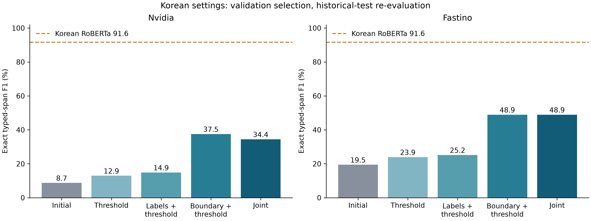
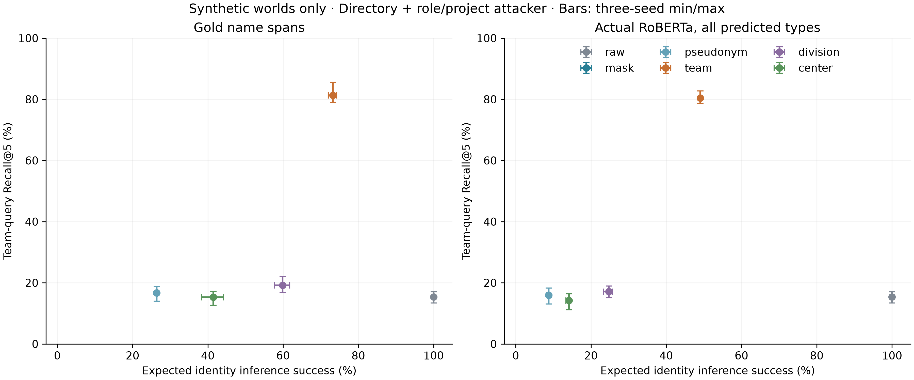

# KoPII: Korean PII Detection and Organization-Aware Generalization for Enterprise Documents

**Working draft — 2026-09-21. Not a submission-ready manuscript.**

Authors, affiliations, venue, and acknowledgements are intentionally unspecified. We distinguish the archived September 15 adoption study from a September 21 settings re-evaluation and a controlled synthetic policy study. The new tests have completed; independent real-world validation remains outstanding.

## Abstract

Korean enterprise documents contain personal identifiers alongside organizational information useful for document retrieval and task assignment. We present KoPII, a modular implementation that separates span detection, external organizational context resolution, and replacement policies. The implementation supports Korean BIO token classifiers, two GLiNER-family adapters, and deterministic rules, together with masking, document-scoped pseudonyms, and organization-based replacement. An archived adoption study compared a Korean-fine-tuned RoBERTa checkpoint with two initially considered public PII models on 2,006 Korean dialogue-derived records and 580 synthetic negative records. The Korean model achieved 91.10% exact typed-span F1 on the common evaluation categories. These results are conditional on the evaluated configurations: the candidates were not adapted or tuned for Korean, and their default word boundaries could not exactly represent many annotated Korean names. A subsequent validation-only search evaluates 30 label, threshold, and boundary configurations per candidate and re-evaluates the historical test. In three fictional organizations comprising 720 documents, gold-name team replacement increases team-query Recall@5 from 16.73% to 81.30% relative to masking, while increasing expected identity-inference success from 26.39% to 73.21% for a directory-plus-role/project attacker. These measurements demonstrate a conditional trade-off rather than a jointly superior privacy–utility policy. They do not establish performance with production embeddings, real employee data, or an untouched business-document test set.

## 1. Introduction

Document processing systems need to restrict exposure of personal information while retaining the information required for authorized tasks. A document may identify an employee by name even when its downstream use requires only the responsible organizational unit. Replacing every name with one marker removes this distinction, whereas retaining a team label may reveal additional identifying context. The choice should therefore be evaluated as a task-dependent trade-off.

The initial engineering investigation considered NVIDIA GLiNER-PII and Fastino GLiNER2-PII for adoption. Evaluation in Korean motivated a comparison with a Korean-fine-tuned RoBERTa checkpoint and an analysis of particle boundaries and false positives. This is the context of the archived comparison; it does not establish the optimal ranking of these model families.

This draft contributes an explicit system decomposition, a bounded Korean configuration study, and a controlled synthetic analysis of organization-aware replacement. The policy study exposes a retrieval–identification trade-off and failures caused by stale directories and additional context masking; it does not identify a universally superior policy. We do not introduce a new transformer architecture or claim that context-preserving anonymization is a new task.

## 2. Related Work

GLiNER uses a bidirectional transformer for flexible entity extraction, providing a relevant model family for promptable PII detection. The architecture paper should not be conflated with the language coverage or tuning of particular PII checkpoints. [Zaratiana et al., 2024](https://aclanthology.org/2024.naacl-long.300/)

TAB evaluates text anonymization with annotations and metrics that account for privacy and retained utility beyond ordinary entity detection. This motivates separating exact detection metrics from document-level privacy outcomes. [Pilán et al., 2022](https://aclanthology.org/2022.cl-4.19/)

RAT-Bench assesses re-identification risk using direct and indirect identifiers and an attacker model. Its demographic setting should not be transferred directly to Korean organizations. [Krčo et al., 2026](https://arxiv.org/abs/2602.12806)

Adaptive Text Anonymization studies strategies tailored to privacy requirements and downstream utility. Our proposed focus is a Korean, directory-grounded implementation and controlled study; novelty relative to adaptive and knowledge-based approaches requires a fuller literature review. [Loiseau et al., 2026](https://arxiv.org/abs/2602.20743)

**Before submission:** extend this section with original sources for the Korean corpora, KLUE pretraining, synthetic PII generation, Korean de-identification, entity linking ambiguity, and organization-aware generalization. Cite the actual upstream datasets, not only the combined Hub upload.

## 3. Task and Assumptions

For an input string x, a detector predicts spans (start, end, type, score) using half-open Unicode character offsets. A resolver maps selected name surfaces to organizational context or an unresolved status. A policy transforms detected spans into generic markers, document-scoped pseudonyms, or organization labels. The output includes transformed text and replacement offsets.

The intended downstream task initially concerns the responsible organization, not recovery of a named person's identity. An organization label is not assumed to be non-identifying: team size, title, time, and project context may enable identity inference. A directory is available to the processing service; whether an attacker has the same directory must be specified per experiment.

Name matching does not constitute unique-person identification. Multiple employees with the same name and team may resolve to one organizational label. Different teams remain ambiguous even if their parent unit is the same. Pseudonyms identify a surface within a document, not a unique person in the world.

## 4. Data

### 4.1 Archived resource

The published Korean PII collection comprises 100,851 records: 78,963 training, 9,994 validation, 9,888 internal test, and 2,006 separate KDPII-derived evaluation records. It combines public Korean material, modified public contexts, templated business documents, and negative examples. Some source values remain from public material; the complete collection is not purely synthetic.

The 2,006-record evaluation segment contains 458 dialogues and 1,548 utterance-derived records. These are dependent observations. The 580 negative records are a subset of the internal test material and share the synthetic generation family with training data.

### 4.2 New research data protocol

Source documents and their derivatives must share a group ID. Template families and source groups should be separated before tuning. The existing test has already informed error analysis, so final claims about improvements require an untouched evaluation set or an explicit limitation on independence.

The package's six-template fixture generator is only for execution tests. It neither reconstructs the historical corpus nor supplies a credible new business-document benchmark. Provenance, annotation instructions, annotator agreement, licensing, group mapping, and independent evaluation data remain required before submission.

## 5. Method

### 5.1 Detection adapters

A common adapter returns original-text character spans. The Korean token-classification adapter uses a fast tokenizer and overlapping token windows, selecting predictions with more surrounding context for duplicated token offsets. GLiNER adapters expose model revision, label prompts, threshold, character-window size, overlap, and batch size. They remove exact duplicate predictions while retaining nonidentical conflicting spans for evaluation. An optional `ko_syllable` boundary mode splits Hangul syllables within native word tokens while retaining original character offsets and non-Hangul boundaries. This changes both boundary representability and the effective span-width distribution; it is not morphological analysis or additional training. Windows can be batched across documents without sharing their offset spaces.

### 5.2 Organizational context and replacement

Resolution is independent of model weights. The reference implementation uses an explicitly fictional CSV directory with team, division, and center fields. Application-specific database resolvers can implement the same bulk interface.

Runtime overlapping detections cover their union. If types conflict, the merged region receives a generic PII marker. This coverage-oriented runtime behavior is distinct from raw detector evaluation. Organization resolution is applied to person-name spans only. Unresolved context falls back to a keyed document-scoped pseudonym where configured, and otherwise a generic marker. The method does not guarantee anonymity or grammatical particle correction.

### 5.3 Research execution

The runner records configuration, immutable model revision, data hash, source hash, major package versions, and execution environment. Checkpoints contain predicted positions without copying document text. Run identity changes reject continuation; checkpoint writes are atomic and concurrent writers are excluded.

Exact typed-span precision, recall, F1/F5, label-agnostic character coverage, full-span coverage, and negative-document error rates are reported separately. Optional intervals resample whole source groups. The current runner measures per-document wall time only as a diagnostic, not a production latency benchmark.

### 5.4 New training baseline versus archived training

The new training implementation is a fixed-epoch cross-entropy baseline with overflow token windows and post-training development evaluation. It is not a reproduction of the archived Focal-loss training with F5 checkpoint selection and truncated 256-token inputs. These choices must be controlled in new ablations rather than silently attributed to the historical checkpoint.

## 6. Archived Adoption Study

The study was conducted on September 15, 2026, on Apple M4 Pro using PyTorch MPS, with the same evaluation records for all three models. Exact F1 uses 13 corresponding categories on the 2,006 KDPII-derived records; negative-document errors use the separate 580 records. Exact matches require both boundaries and type. Model/data revisions and execution details are preserved in the linked report.

| Checkpoint | Exact F1 | Person-name recall | Negative documents with a false positive |
|---|---:|---:|---:|
| Korean RoBERTa | 91.10% | 96.05% | 0 / 580 |
| NVIDIA GLiNER-PII | 8.73% | 12.43% | 559 / 580 |
| Fastino GLiNER2-PII | 19.87% | 18.36% | 182 / 580 |

Source: [archived report](../docs/public/benchmark-results.md) and [aggregate data](../docs/public/benchmark-results.json). These values were not recomputed using the new package. Historical and new windowing/overlap behavior differ, and the records do not establish performance on an untouched business-document test set.

Of 354 annotated names, 244 were not exactly representable by the two candidates' default word boundaries. This supports investigating a boundary constraint but does not quantify its causal contribution to the total gap. Character recall was 88.53% for NVIDIA and 81.45% for Fastino; broad overprediction can increase coverage without improving exact extraction.

The candidate label prompts and thresholds were not tuned on Korean validation data, and the candidates were not fine-tuned on the same Korean corpus. Their initial deployment suitability in this setting is therefore the supported interpretation, not universal model superiority. The study does not measure production HTTP behavior, organizational matching accuracy, downstream utility, or re-identification risk.

## 7. New Configuration and Policy Experiments

### 7.1 E2: validation-only settings search

The development set contains all 412 original dialogues (L1) from the published validation split and 200 synthetic negatives (L4), selected by a prespecified seed/hash order. Derived utterances and translated/synthetic positive documents are excluded from development. Each candidate receives the same 30-setting budget: three label profiles (original, descriptive English, Korean), two boundaries (native, Hangul syllable), and thresholds {0.1, 0.3, 0.5, 0.7, 0.9}. We maximize development exact micro F1, including negative-document predictions as false positives; ties prefer recall and then fixed grid order. No weights are updated.

All conditions use pinned checkpoints, MPS float32, 180-character windows with 48-character overlap, and batch size four. Confidence-first greedy decoding permits filtering the minimum-threshold output. For each prompt/boundary variant, direct inference at thresholds 0.3 and 0.7 on 12 development records must reproduce cached span/type decisions. Both candidates complete all 144 checks. Selected settings are saved before test inference. An initial Fastino run stopped after 96 development records because upstream preprocessing appended a period to non-punctuated windows. We explicitly model and invert that known synthetic suffix, retain strict checks for all other invalid offsets, and restart Fastino without reusing failed-run predictions. The unaffected completed NVIDIA component retains its original source snapshots and run identity; an AST/source-hash check verifies its unchanged execution path before combining aggregates. No search settings or evaluation examples were changed.

The test consists of the historical 2,006 KDPII-derived records plus 580 synthetic negatives. Exact F1 is reported on KDPII alone; negative-document errors are separate. Both metrics are restricted to the 13 common categories, rather than all 20 types predicted by RoBERTa. This is explicitly a historical-test re-evaluation, because the test previously informed boundary error analysis. Exact text and explicit conversation-ID overlap between training, selected development, and KDPII are zero; this does not establish semantic or template-family independence.

| Model / condition | Exact F1 | Name recall | Character recall | Negative documents with FP |
|---|---:|---:|---:|---:|
| nvidia / baseline | 8.71% | 12.99% | 88.60% | 559 / 580 |
| nvidia / joint | 34.44% | 13.56% | 49.95% | 354 / 580 |
| fastino / baseline | 19.45% | 18.08% | 81.31% | 182 / 580 |
| fastino / joint | 48.93% | 6.21% | 71.62% | 182 / 580 |
| roberta / reference | 91.65% | 95.48% | 99.21% | 0 / 580 |

Intervals resample all derived records with their original dialogue in 458 source groups, using 1,000 bootstrap samples. They are intervals for the fixed selected configurations, not selection-adjusted intervals or paired significance tests. The full grid and additional threshold-only, labels-plus-threshold, and boundary-plus-threshold conditions appear in [the study report](../research/RESULTS.md). Comparisons among re-optimized conditions do not isolate a single variable at a fixed threshold. An optimum at the edge of the grid does not establish a globally optimal threshold. These candidates remain unadapted in weight space, whereas the reference RoBERTa is Korean-fine-tuned.

The aggregate F1 improvement does not imply better name protection. Fastino name recall decreases from 18.08% to 6.21%, while the Korean reference reaches 95.48%. Character recall decreases from 88.60% to 49.95% for NVIDIA and from 81.31% to 71.62% for Fastino. Both selected settings have zero address recall. Improvements concentrate in categories such as telephone numbers and email, indicating that this micro-F1 selection objective is not a privacy-recall operating point. NVIDIA’s boundary-plus-threshold condition scores higher on the test than its development-selected joint condition; we retain the development selection rather than selecting on test outcomes.

### 7.2 E3: fictional organizations and fixed downstream systems

We instantiate three prespecified random seeds, each with 120 fictional identities in 16 teams, four divisions, and two centers. Team sizes are 2, 4, 8, and 16. Two documents per identity yield 720 documents across the three worlds. The service directory includes cross-team and within-team homonyms, missing entries, stale affiliations, and multiple-team ambiguity. Names are generated Korean syllable combinations, and all organization and business records are fictional.

We compare raw text, masking, document-scoped pseudonyms, and team/division/center replacement. In the gold condition, only annotated name spans are replaced. In the end-to-end condition, the pipeline processes all types actually returned by RoBERTa. The same original documents, queries, character-bigram BM25 retriever, and attacker rules are used across policies. Organization-conditioned queries specify team, division, or center together with topic and half-year; topic/period-only queries serve as a control. Query templates are separately worded but share a limited topic vocabulary with document generation. Relevance is determined by source metadata, never supplied to the retriever.

The attacker observes released text and one of three knowledge sets: candidate identities/names only; a current identity-to-organization directory; or that directory plus role/project assignments. Even the first condition assumes a known closed-world identity universe. Names and disclosed category markers filter candidates; auxiliary conditions also use role and project clues only when present in the released text. Target identity and original spans are used only for scoring. We report realized top-1 decisions under a seed-fixed pseudorandom tie order and expected success under uniform ties: 1/|C| if the true identity remains in C, and zero otherwise. Empty candidate sets abstain. Candidate counts alone are not treated as anonymity guarantees.

### 7.3 Measured utility–risk trade-off

| Policy | Gold-name Recall@5 | Actual-NER Recall@5 | Gold-name expected attack success | Actual-NER expected attack success |
|---|---:|---:|---:|---:|
| raw | 15.42% | 15.42% | 100.00% | 100.00% |
| mask | 16.73% | 15.99% | 26.39% | 8.76% |
| pseudonym | 16.73% | 15.99% | 26.39% | 8.76% |
| team | 81.30% | 80.45% | 73.21% | 49.01% |
| division | 19.20% | 17.11% | 59.88% | 24.76% |
| center | 15.30% | 14.19% | 41.45% | 14.12% |

Values are equal-weight means across the three worlds, with per-world values and min/max ranges in the released aggregates. These ranges are not population confidence intervals. Recall@5 is the fraction of relevant documents retrieved, not an any-hit rate; many queries have more than five relevant documents. Under gold spans, division replacement yields 58.67% Recall@5 for division queries, and center replacement yields 32.40% for center queries. Team labels are not expanded to their ancestors in the index, limiting retrieval for higher-level organization queries. Topic-only MRR saturates at 100% under every policy, so this control supplies no evidence of broad semantic-retrieval improvement.

The directory-plus-auxiliary attacker reaches 90.32% expected success for two-person teams and 65.84% for sixteen-person teams under gold team replacement. Stale directory entries produce incorrect team markers in 5% of documents. An attack failing because the service disclosed a wrong affiliation should not be interpreted as a successful privacy policy; expected auxiliary-attack success is 84.47% in the current-directory subgroup under gold team replacement. The experiment assumes a current attacker directory and an imperfect service directory, not a dynamic model of reorganizations or directory compromise.

### 7.4 Additional context removal and extractive answers

RoBERTa exactly detects all 720 synthetic names, demonstrating the simplicity of this name-generation regime rather than general name-detection performance. It additionally emits 609 POSITION, 112 AFFILIATION, and 637 PASSPORT_NUM spans. Post-hoc inspection confirms that all 637 passport predictions are within fictional business-reference strings; no passports were generated. Position and affiliation spans are not automatically counted as false positives because only names have gold annotations.

A fixed extractive reader searches by a business-reference key and reads an organization marker from the top-ranked document, using the public organization hierarchy but no employee-to-organization directory. It abstains on raw/masked names because those texts contain no organizational answer. This is not a generative QA benchmark. For team replacement, reference-query source top-1 accuracy drops from 86.11% with gold names to 11.39% with actual predictions; team-answer accuracy drops from 74.17% to 34.17%. Answer accuracy can exceed correct-source retrieval when a different document shares the target organization. These diagnostic measures must be read together.

The lower auxiliary attack success with actual predictions partly reflects removed roles/projects, while business-reference removal harms retrieval. It is not an improvement in name detection, which is perfect in this narrow synthetic setup. These observations were diagnosed after the run; no generator or policy was reselected using them. Same-data model adaptation and E1 data-composition training ablations remain unexecuted.

## 8. Limitations and Data Governance

Detection comparisons are conditional on asymmetric adaptation and a partly dependent, previously analyzed evaluation corpus. The policy experiment uses three small fictional worlds, lexical retrieval, a constrained extractive reader, and a closed-world candidate-filtering attacker. Its task vocabulary favors matching a retained organization level, and neither stronger attackers nor production NPU embeddings were evaluated. We also did not compare masked text with access-controlled organizational metadata filtering; the study therefore does not establish that releasing organization labels in the text is necessary for useful retrieval. Synthetic negatives do not represent all operational false positives. Directory errors, small teams, homonyms, stale hierarchies, and indirect identifiers remain material risks. No mathematical anonymity, differential privacy, or legal compliance guarantee is established.

The public release contains fictional organization examples, not a customer directory or customer document corpus. Publication permissions for each upstream dataset and model must be checked independently of the repository's MIT code license. The original document store, access controls, and any preprocessing before PII detection remain application responsibilities.

## 9. Reproducibility and Submission Status

The package, pinned checkpoint configurations, E2/E3 protocols and runners, aggregate results, figures, and executed review notebook are released. Source/data hashes, dependency versions, settings grids, and per-world diagnostics accompany the measurements. Raw source texts and per-record PII predictions are excluded from the public repository. Runtime tests and the minimal training pass separately verify software behavior; they do not establish the E1 data-composition hypothesis.

The submission remains incomplete pending independent business-document data, same-data adaptation/data-composition comparisons, operational retrieval and stronger-attack validation, and a fuller literature review. The current measurements support the bounded findings above rather than deployment-wide privacy or accuracy guarantees. [Research plan](../research/PLAN.md) tracks these requirements. Bibliographic metadata is provided in [references.bib](references.bib).
