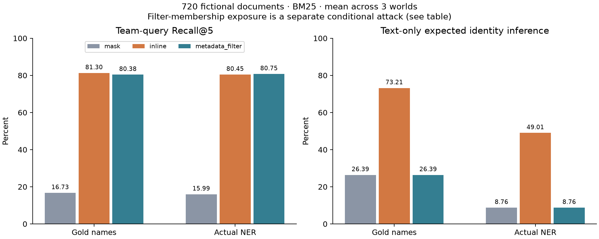

# 조직 메타데이터 검색 후속 실험

E3 결과를 본 뒤 추가한 비교다. 기존 3개 가상 조직·720개 문서·NER 예측을 재사용했으며 독립 업무 평가가 아니다. 기존 BM25 마스킹/본문 치환 점수는 모든 조건에서 이전 실행과 일치함을 자동 확인했다.

## 같은 문서 전체를 대상으로 한 비교

각 수준의 Recall@5는 그 수준을 명시한 질의에 대한 값이다. 개인 추정은 명부·직급·프로젝트를 아는 공격자가 **본문만 보는 조건**, 분모는 전체 720개 문서다. 값은 세 세계의 평균이며 괄호는 최솟값–최댓값이다. 이 범위는 모집단 신뢰구간이 아니다.

### gold

| 수준 | 방식 | Recall@5 % (범위) | 본문 개인 추정 % (범위) | 빈 결과 질의 % |
|---|---|---:|---:|---:|
| team | mask | 16.73 (13.95–18.78) | 26.39 (25.83–26.67) | 0.00 |
| team | inline | 81.30 (78.98–85.52) | 73.21 (72.04–74.21) | 0.00 |
| team | metadata_filter | 80.38 (77.19–84.72) | 26.39 (25.83–26.67) | 0.00 |
| division | mask | 16.66 (16.31–17.28) | 26.39 (25.83–26.67) | 0.00 |
| division | inline | 58.67 (56.22–60.57) | 59.88 (57.73–61.72) | 0.00 |
| division | metadata_filter | 58.67 (56.22–60.57) | 26.39 (25.83–26.67) | 0.00 |
| center | mask | 17.17 (16.32–18.34) | 26.39 (25.83–26.67) | 0.00 |
| center | inline | 32.40 (31.51–33.28) | 41.45 (38.34–44.14) | 0.00 |
| center | metadata_filter | 32.40 (31.51–33.28) | 26.39 (25.83–26.67) | 0.00 |

### roberta

| 수준 | 방식 | Recall@5 % (범위) | 본문 개인 추정 % (범위) | 빈 결과 질의 % |
|---|---|---:|---:|---:|
| team | mask | 15.99 (13.10–18.28) | 8.76 (8.40–9.11) | 0.00 |
| team | inline | 80.45 (78.68–82.72) | 49.01 (48.57–49.61) | 0.00 |
| team | metadata_filter | 80.75 (78.04–84.98) | 8.76 (8.40–9.11) | 0.00 |
| division | mask | 16.66 (15.95–17.71) | 8.76 (8.40–9.11) | 0.00 |
| division | inline | 58.86 (56.95–60.32) | 24.76 (23.33–25.72) | 0.00 |
| division | metadata_filter | 58.58 (56.03–60.39) | 8.76 (8.40–9.11) | 0.00 |
| center | mask | 16.93 (16.21–17.97) | 8.76 (8.40–9.11) | 0.00 |
| center | inline | 32.52 (31.88–33.28) | 14.12 (13.36–14.57) | 0.00 |
| center | metadata_filter | 32.34 (31.31–33.28) | 8.76 (8.40–9.11) | 0.00 |

## 필터가 알려졌을 때: 같은 조회 성공 문서끼리 비교

각 세계의 240개 중 212개, 총 **636개(88.33%)**에 조직 메타데이터가 있다. 아래 모든 공격 점수는 이 동일한 부분집합을 분모로 삼는다. 공격자가 문서가 반환된 조직 필터를 알면 그 조직을 단서로 추가한다. 이는 관찰 가능한 경우의 조건부 위험이며, 실제 top-5 반환 빈도·질의 분포·로그 접근 빈도를 측정한 값은 아니다.

| 탐지 | 수준 | 본문 치환: 본문 관찰 % | 메타데이터: 본문만 % | 메타데이터: 필터도 관찰 % |
|---|---|---:|---:|---:|
| gold | team | 79.66 | 26.66 | 79.66 |
| gold | division | 64.57 | 26.66 | 64.57 |
| gold | center | 43.71 | 26.66 | 43.71 |
| roberta | team | 54.26 | 8.69 | 54.26 |
| roberta | division | 26.80 | 8.69 | 26.80 |
| roberta | center | 14.75 | 8.69 | 14.75 |

## 해석과 범위

- 본문에 조직명을 직접 넣지 않아도, 별도 메타데이터 필터로 이 합성 조직 질의의 검색 품질을 비슷하게 유지했다. 차이에 대한 통계적 동등성 검정은 하지 않았다.
- 본문만 유출되는 조건과 검색을 사용할 수 있는 공격자를 구분해야 한다. 같은 조회 성공 문서에서는 필터 관찰 위험이 본문 치환 위험과 같았다.
- 실제 NER 조건의 낮은 공격 점수에는 직급·프로젝트 등 추가 정보 삭제가 작용한다. 이를 더 정확한 이름 탐지로 해석하지 않는다.
- 명부 누락·모호성은 메타데이터 없음으로 남고, 오래된 명부의 잘못된 범주는 정답으로 교정하지 않는다. 전체 검색으로 폴백하지 않는다.
- 전체 조직 조회가 허용된 가상 사용자를 가정한다. 권한 검사 함수의 거부 동작만 테스트했으며 제품 인증·문서 ACL·로그 보호를 검증한 실험이 아니다.
- 본문은 고정 템플릿이고, 질의 조직명은 알려진 문자열로 파싱한다. 실제 업무 자료·운영 NPU 임베딩·LLM QA·강한 공격자는 미측정이다.

재현: [실행 안내](../METADATA_STUDY.md). 전체 시드별 집계: [JSON](metadata-retrieval.json).
